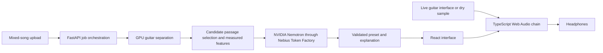

# ToneForge — requirements, architecture and delivery plan

Planning baseline: 24 October 2026. All dates and working times below are **MYT (UTC+8)**.

## 1. Product and preserved decisions

ToneForge helps a guitarist hear a tone in a mixed song, extract a useful guitar reference, and get a playable approximation through a browser amp/effects chain.

The decisions supplied by Isyraf are the baseline:

- Three people: **Isyraf** owns AI, FastAPI, Nebius/NVIDIA integration and ML analysis; **Dinnie** owns the TypeScript Web Audio DSP engine; **Shazlin** owns the React/TypeScript frontend.
- Core MVP: mixed-song guitar isolation, automatic reference passage selection, NVIDIA/Nebius-powered preset generation, a functional browser amp/effects chain, and live audio-interface input.
- Short tabs are optional.
- Deadline: **31 October 2026 at 01:00 MYT**.

The old ChatGPT conversation was read, but its detailed assistant answers were returned as reference placeholders. This plan does not claim to recover technical choices hidden behind those placeholders. Architecture, limits and acceptance targets below are new proposals for the team to validate.

## 2. Hackathon requirements and product fit

Sources checked on 24 October: [event overview](https://nebiusglobalaihackathon.devpost.com/) and [official rules](https://nebiusglobalaihackathon.devpost.com/rules).

The event deadline of 30 October, 10:00 PDT converts to the preserved deadline above. Requirements to account for:

- Runtime use of Nebius Token Factory or Nebius AI Cloud, plus at least one NVIDIA open-source model.
- A working demo/test-build URL, project description, track selection, public source repository with an open-source licence and reproducible setup instructions.
- A public YouTube demo under three minutes, using material the team is authorized to show.
- Describe NVIDIA/Nebius usage and provide platform feedback. Supply English materials and maintain judging access through the end of judging, currently 15 December 2026, 12:00 Pacific Time.

**Proposed track:** Best Apps and Agents. Make preset generation a meaningful runtime use of NVIDIA Nemotron through Nebius. Running Demucs on an NVIDIA GPU alone does not establish use of an NVIDIA-authored open-source model.

Build the demo around product usefulness: one obvious target guitar sound, visible analysis, an editable generated preset, and an audible dry/processed comparison. Save actual model/provider identifiers, durations and sanitized inference evidence. Confirm the final rules again before submitting.

## 3. Scope and acceptance criteria

The journey is: **upload → separate guitar → select passage → generate preset → audition → connect guitar → play and adjust**.

Proposed upload limit: WAV/MP3, up to five minutes and 50 MB, with backend validation of decoded content. Confirm these limits after the first GPU benchmark. Do not accept arbitrary media URLs in the MVP.

| ID | Requirement | Owner | Acceptance evidence |
|---|---|---|---|
| R1 | Mixed-song upload and guitar isolation | Isyraf; Shazlin handles UI | At least three rights-cleared clips exercise clean, distorted and dense mixes; reviewers can hear the guitar stem. Invalid or undecodable files produce a useful error. |
| R2 | Automatic reference passage | Isyraf | Return a default 10–20 second interval within the source duration, an explanation and confidence/quality flags. Silence is rejected; low-quality material prompts another selection or file. User can audition and override the interval. |
| R3 | NVIDIA/Nebius preset generation | Isyraf | A real runtime inference produces a strict, versioned preset using only implemented controls. Validate enum values, units, ranges and finite numbers. Invalid/provider-failed results never appear as successful AI output. |
| R4 | Browser amp/effects processing | Dinnie | A known dry recording audibly changes through the actual chain. Presets and manual controls affect audio, bypass works, output stays finite, and repeated starts do not create duplicate graphs. |
| R5 | Live audio-interface input | Dinnie; Shazlin handles controls | Demonstrate on the actual Windows laptop, interface and headphones. Select the input/channel, start/stop safely, and recover from denied permission or device removal. Record observed latency and driver settings. |
| R6 | Complete frontend flow | Shazlin | Upload, stage progress, stem/reference playback, preset explanation, amp controls, input controls and errors are connected. Keyboard labels and focus are usable; double clicks cannot launch duplicate jobs. |
| R7 | Audition without hardware | Dinnie + Shazlin | A licensed dry guitar sample passes through the same graph and preset as live input. Judge can hear a result without owning an interface. |
| R8 | Integrated delivery and evidence | Isyraf coordinates; all contribute | Clean setup succeeds on another laptop. Demo, source, required model evidence, licence and video are ready before the working target. |
| O1 | Short tablature | Isyraf; Shazlin displays | Optional after R1–R8 work. Restrict to a short monophonic phrase; show uncertainty and allow omission. Never gate preset generation on tabs. |

**Quality targets, not current measurements:** warmed analysis of a 60-second clip in at most 90 seconds on the selected cloud GPU; preset inference within 15 seconds; sustained live processing without audible dropouts for two minutes. Aim for measured live round-trip latency at or below 30 ms on the demo rig. If this is missed, document the measurement and improve the rig/graph before promising live playability. `baseLatency` alone is not a round-trip measurement.

No claim of perfect separation, exact equipment recognition, universal guitar compatibility or validated perceptual similarity. A mixed recording cannot uniquely reveal the original instrument, pickups, performance, amplifier and recording setup.

**Deferred:** custom model training, neural amp capture, DAW/VST plugins, accounts, billing, social presets, arbitrary effect graphs, full-song/polyphonic tabs and mobile optimisation. Live input and mixed-song isolation remain core even when a prerecorded fallback helps the presentation.

## 4. Ownership and integration boundaries

| Person | Owns | First deliverable | Supplies to the others |
|---|---|---|---|
| Isyraf — `mzisyraf` | `services/api/`, ML evaluation, provider integration, deployment, final integration | One real separated guitar clip, ranked reference candidates, one valid preset from NVIDIA on Nebius | Job/status/result fixtures; preset schema and examples; local API instructions; model provenance and failure responses |
| Dinnie — `dinni3` | `packages/audio/`, DSP behaviour, device lifecycle, audio performance | Dry sample and actual interface input through one audible processing chain | Engine API, supported controls/ranges, safe defaults, input/channel requirements, latency findings |
| Shazlin — `shazlinn` | `apps/web/`, interaction design, browser API client and UI state | Clickable end-to-end flow using clearly labelled fixtures | Component/control inventory, job-state screens, frontend setup, integrated demo presentation |

Each owner reviews changes in their area. **Isyraf + Dinnie** jointly settle the preset schema; **Isyraf + Shazlin** settle job/result/error responses; **Dinnie + Shazlin** settle engine lifecycle and control updates. Do not allow two competing definitions of the same preset.

Use a single repository, npm workspaces for web/audio, and a separate Python environment. Avoid additional build orchestration initially. Freeze the first shared contract by **25 October, 12:00**. All members can start with fixtures while their integration partner builds the real implementation.

## 5. Architecture proposal

Keep heavy analysis in Python; keep live playing entirely in the browser. Do not stream live guitar through cloud inference. The separated stem is for reference listening and feature extraction; applying another amp to an already processed stem is not the core dry-guitar audition.

### Python / AI path — Isyraf

1. Validate byte size, file type, decoded duration and channels; generate a server-side ID and store outside the public web root. Treat filenames and metadata as untrusted data.
2. Benchmark **Demucs `htdemucs_6s`** as the initial guitar separator on a Nebius GPU. It exposes a guitar source; the usual four-source model does not. The upstream repository is archived and describes the six-source model as experimental: pin a tested environment/model and judge the actual audio before committing to it. Use a separate GPU process/environment if its dependency requirements conflict with the API.
3. Rank sliding reference windows using guitar energy, guitar-to-mixture ratio and penalties for silence, clipping, bleed and unstable tone. Return time bounds and quality flags. These are heuristic indicators, not calibrated confidence probabilities. Let users change the passage.
4. Measure features such as spectral balance, brightness, dynamics and sustain. Treat effect estimates as uncertain; do not infer a reliable delay/reverb value from one crude feature. Calibrate against known dry/processed fixtures.
5. Send measured features, quality flags and the exact supported-control schema to an **NVIDIA Nemotron model available to this Nebius account**. Select and record the exact model ID only after a successful authenticated runtime call; do not invent availability or assume the text model can listen to raw audio.
6. Parse and validate the result in FastAPI before returning it. Permit at most one repair attempt for invalid output. Use a finite timeout and limited retry for transient failures; surface failure after that. Return a labelled baseline preset only if offered explicitly, with provenance distinguishing it from successful AI generation.
7. Cache by audio hash, passage, separator version, feature version, schema version and inference model. Keep API keys on the server. Record per-job runtime and token/cost information when supplied by the provider; set a team-approved spend ceiling before running batches.

For the hackathon start with one worker and one GPU job at a time. Persist status metadata and artifacts on disk; no Redis/database requirement initially. Heavy inference must run outside the web request/event loop. On restart, mark interrupted jobs as failed rather than leaving them running forever. Add distributed queues only if the actual deployment needs multiple workers.

### Audio engine — Dinnie

Proposed fixed graph: **input gain → optional compressor → overdrive/amp waveshaping → tone EQ → cabinet filter or licensed impulse → delay → reverb → master gain/output protection**.

Start with native Web Audio nodes and one fixed order. Introduce AudioWorklet only when required by custom processing or measured performance. Publish supported controls before AI preset work expands. Use ramps for parameter changes, constrain delay feedback, avoid accidental feedback routes, and clean up nodes/tracks on stop. Never play a processed path and a hidden second dry path at the same time.

On a user gesture, create/resume the context and request input permission. Request disabled echo cancellation, noise suppression and automatic gain control, then inspect actual device settings because constraints may not be honoured. Test mono channel selection for a guitar plugged into one channel of a stereo interface. Use headphones, conservative initial output and a visible stop/mute control. Target desktop Chrome/Edge on the demo Windows rig first. HTTPS or localhost is needed for media capture.

### Frontend — Shazlin

Use React + TypeScript + Vite. Main sections: upload/job progress; mixed/stem/reference listening; preset and explanation; amp/effects controls; input selection and output level; dry/processed comparison. Keep job state separate from audio-engine state. Render model text as plain text, never executable instructions or HTML. Audio engine receives validated data; it does not fetch AI responses itself.

Use simple semantic controls first. Show stage names instead of fabricated progress percentages. Fixture mode must be labelled and separate from the live API path. A failed analysis retains an actionable error and retry/new-file path. Clean up players and active sources when switching inputs.

## 6. Shared contract to freeze first

This section describes the target contract. A runnable starter now implements only `GET /api/health`, `GET /api/presets/example`, and an explicit HTTP 501 response for `POST /api/jobs`. `contracts/preset.schema.json` is a shared draft covering only the currently implemented gain/drive/EQ/master controls. It still needs team review in issue #1. See DEVELOPMENT.md for setup and current limits.

| Interface | Initial shape |
|---|---|
| `POST /api/jobs` | Multipart `file`; return HTTP 202 and `{ job_id, status }`. Enforce limits before expensive processing. |
| `GET /api/jobs/{id}` | `{ job_id, status, stage, result?, error? }`; poll about once a second while nonterminal. |
| Job lifecycle | `queued → separating → selecting → generating → ready`, or `failed` from any active state. |
| Result | Guitar stem URL, `{ start_seconds, end_seconds, quality_flags }`, measured features, preset and inference provenance. |
| Artifacts | Server-generated IDs/allowlisted artifact names; bound access token or authenticated job scope for remote demos. No arbitrary filesystem paths. |
| Error | `{ code, message, retryable }`; never expose secrets or stack traces. |
| Engine | `initialize()`, `startSample(buffer)`, `startLive(deviceId, channel)`, `applyPreset(preset)`, `setBypass(boolean)`, `stop()`, `dispose()`. |

Preset envelope: `schema_version: "1"`, `name`, `description`, `quality_flags`, `parameters`, and provenance including provider, exact model ID and whether the response is live/generated or a fallback. Timestamps and analysis runtime are metadata, not DSP controls.

Proposed parameters: input gain in dB, compressor enabled/threshold/ratio, drive normalized 0–1, low/mid/high EQ in dB, a cabinet enum chosen from implemented options, delay milliseconds/feedback/wet, reverb wet, and master gain in dB. Dinnie supplies exact safe ranges, defaults and transfer functions; Isyraf validates the same values; Shazlin displays the same units. Unknown fields and unsupported effects fail validation. JSON must contain finite numeric values, not NaN/infinity. Commit one example preset, one job result, one failure result and shared validation cases before independent integrations diverge.

## 7. Delivery schedule and work packages

Dates are proposed checkpoints, not estimates of each person's available hours. Start with a 30-minute kickoff to confirm availability, hardware and interface decisions.

| Date | Isyraf | Dinnie | Shazlin | Exit check |
|---|---|---|---|---|
| Oct 24 evening | Check Nebius access/credits; start GPU and separation feasibility | Check guitar, interface, drivers and headphones | Sketch flow and screens | Everyone can access repo; blockers named |
| Oct 25 | First real separation + NVIDIA/Nebius inference; freeze contract by noon | Prove live input and dry-sample path; publish controls | Build fixture-driven flow | All three can consume the same preset/result |
| Oct 26 | Automatic passage selection + async API | Working amp/EQ/cabinet and lifecycle | Upload, polling and listening integration | Mixed upload reaches reference playback |
| Oct 27 | Validated AI presets and quality flags | Delay/reverb, bypass, safe parameter changes | Preset UI and device controls | AI preset produces audible browser processing |
| Oct 28 | Integrate/deploy analysis path | Measure live rig, fix channel/latency issues | Complete real API + engine flow | Full upload-to-live-play demonstration |
| Oct 29 | Reliability, benchmark evidence and provider provenance | Audio regressions and hardware recovery | Error/accessibility pass and polish | Core acceptance checks pass; optional tabs only now |
| Oct 30 daytime | Reproducible setup, rights/licence checks and submission copy | Rehearse rig and dry-sample fallback | Screenshots and short demo video | Fresh-laptop walkthrough succeeds |
| Oct 30 by 22:00 | Coordinate complete submission | Final audio check | Final demo/description check | Submit with three-hour buffer |
| Oct 31 01:00 | Hard deadline | Hard deadline | Hard deadline | No last-minute feature work |

The initial work packages are live in GitHub:

| Issue | Owner | Checkpoint |
|---|---|---|
| [#1 Shared contracts](https://github.com/mzisyraf/toneforge/issues/1) | Isyraf coordinates; all agree | Oct 25, 12:00 |
| [#2 Isolation and passage selection](https://github.com/mzisyraf/toneforge/issues/2) | Isyraf | Oct 26 |
| [#3 NVIDIA/Nebius preset generation](https://github.com/mzisyraf/toneforge/issues/3) | Isyraf | Oct 27 |
| [#4 Live interface feasibility](https://github.com/mzisyraf/toneforge/issues/4) | Dinnie | Oct 25 |
| [#5 Browser DSP engine](https://github.com/mzisyraf/toneforge/issues/5) | Dinnie | Oct 27 |
| [#6 React frontend](https://github.com/mzisyraf/toneforge/issues/6) | Shazlin | Oct 28 |
| [#7 Integration and acceptance](https://github.com/mzisyraf/toneforge/issues/7) | Isyraf coordinates; all verify | Oct 28–29 |
| [#8 Submission package](https://github.com/mzisyraf/toneforge/issues/8) | All; Isyraf coordinates | Oct 30, 22:00 |

Owners are listed in issue bodies; teammate assignment depends on accepted invitations.

Daily rhythm: post what works, today's deliverable and blockers in the relevant issue; hold a brief integration check each evening. A change to a shared contract needs both affected owners. Use short feature branches and small PRs against `main`, with the relevant owner reviewing. Treat `main` as the stable demo baseline. No force pushes or direct overwrites of someone else's work.

## 8. Test plan, risks and fallback rules

Use a small rights-cleared fixture set: clean guitar in a mix, distorted guitar, a dense mix, silence/no guitar, an invalid upload and a dry guitar take. Record source permission and what each fixture is intended to prove. Listen as well as computing features. Do not put full commercial songs or model weights in Git.

Minimum checks: bounded uploads; nonempty and finite features; in-range reference interval; schema rejection of unknown/unsafe controls; provider timeout/invalid-output behaviour; job restart failure; preset parameter changes and bypass; repeated start/stop; permission denial/device disconnect; actual GPU and interface timings. For custom DSP, verify finite output and bounded peak on synthetic signals. Have another team member run setup and the full happy path.

| Risk | Early check | Response |
|---|---|---|
| Separation bleed or absent guitar | First-day listening on varied mixes | Flag low quality, allow passage override, tune selection and test another separator if necessary. Do not silently replace isolation with the whole mix. |
| Preset sounds generic or wrong | Compare a few known tones with the actual engine | Simplify controls, calibrate features and prompt, record human listening notes. Present an approximation with editable controls. |
| Text-model output exceeds engine support | Contract/schema examples before independent coding | Reject unsupported controls and test one real generated preset in the browser early. |
| GPU/model access or dependency failure | Real job and real NVIDIA/Nebius call by Oct 25 | Pin a working environment and model. Cached analysis can support rehearsal if clearly disclosed; a functional runtime path remains required. |
| Live playing latency/unreliable interface | Real rig loopback test on Oct 25 | Use suitable device/driver settings, reduce graph load, investigate channel/routing. Prerecorded dry audition supplements rather than completes live-input acceptance. |
| Cloud cost or anonymous abuse | Agree budget and demo access model before hosting | Limit uploads, queue depth, concurrency and per-session requests; expire artifacts; never expose provider credentials in browser code. |
| Scope and coordination | Evening vertical-flow check | Drop tabs and cosmetic additions before cutting core requirements. |

Temporary uploaded audio and derived artifacts should expire, initially after 24 hours. Explain processing and retention in the UI. Keep logs free of raw audio and secrets. For a remotely hosted demo, use HTTPS, restrict CORS to the frontend, and enforce access/rate/size limits. Do not start paid infrastructure or expand spend without a specific team-approved budget.

## 9. Definition of done and remaining decisions

Core is done when one mixed-song upload produces a listenable guitar passage, a validated real NVIDIA/Nebius preset and audible processing of both a dry sample and live guitar through the same engine, with graceful errors and reproducible setup.

Before submission: verify all required deliverables, exact inference provenance, fixture/asset rights, setup from a fresh checkout, and honest limitation statements. Choose and add an open-source licence and authorize public visibility before submitting. Maintain an affordable working judging path rather than leaving an unbudgeted GPU running indefinitely.

Open decisions for the kickoff:

1. Each person's available hours and the actual guitar/interface/laptop demonstration rig.
2. Nebius account access, exact usable NVIDIA model, GPU route, credit expiry and spending cap.
3. Exact engine controls, preset limits and the deployment's demo-access strategy.
4. Licence choice and publication timing; nominate the team submission representative.
5. Permission for the specific reference music, dry guitar and cabinet/reverb assets.

## 10. Implementation references

- [Demucs upstream README](https://github.com/facebookresearch/demucs/blob/main/README.md): six-source guitar separation and maintenance status.
- [Nebius Token Factory API](https://api.tokenfactory.nebius.com/docs): inference interface; actual account/model access still needs testing.
- [MDN getUserMedia](https://developer.mozilla.org/en-US/docs/Web/API/MediaDevices/getUserMedia): capture permission, secure contexts and failure handling.

## Workspace and continuation status

Requested folder: `C:\Users\mzisy\OneDrive\Coding Environments\VS Code\Winrina NVIDEA Hackathon`.
It was inspected while empty, then received the new `mzisyraf/toneforge` repository. This is a personal project, outside the Wiz workspace roots.

The user will open the folder and start the separate Codex coding chat themselves. Use the updated continuation prompt in `TEAM_HANDOFF.md`; it identifies the existing scaffold and avoids repeating setup. No separate coding chat was created by this planning/scaffolding task.
