# modulo — requirements, architecture and delivery plan

Planning baseline: 24 October 2026; workflow revised by Dinnie on 25 October 2026. All dates and working times below are **MYT (UTC+8)**.

## 1. Product and preserved decisions

modulo first captures the user's guitar sound, then uses a selected guitar passage from a song to suggest a playable amp/effects setup. The user tries and adjusts the setup, records their playing, and plays along with a guitar-reduced backing track.

The decisions supplied by Isyraf are the baseline:

- Three people: **Isyraf** owns AI, FastAPI, Nebius/NVIDIA integration and ML analysis; **Dinnie** owns the TypeScript Web Audio DSP engine; **Shazlin** owns the React/TypeScript frontend.
- Core tone-matching flow: connect/calibrate the user's guitar, upload a mixed song, isolate guitar, let the user choose a reference segment, compare source and target audio, generate a validated NVIDIA/Nebius preset, then play and adjust it through the browser engine.
- Recording and guitar-reduced play-along complete the requested workflow after the tone setup works. They are planned deliverables, not implemented features. Automatic passage suggestions support the user's choice rather than replacing it.
- Short tabs are optional.
- Deadline: **31 October 2026 at 01:00 MYT**.

The eleven-step journey below is the working product workflow requested by Dinnie. Technical contracts and acceptance evidence still need the affected owners' review; this document does not claim completed implementation or team-wide approval of new interfaces.

Current implementation baseline: staging `1479796` includes Shazlin's labelled fixture journey and Dinnie's live-capture engine API. Live-input UI controls remain disabled. Calibration/chord analysis, real song separation, integrated passage selection, real AI generation, recording and play-along are not demonstrated by that baseline. The offline reference selector is a prototype, not a connected song-analysis service.

## 2. Hackathon requirements and product fit

Sources checked on 24 October: [event overview](https://nebiusglobalaihackathon.devpost.com/) and [official rules](https://nebiusglobalaihackathon.devpost.com/rules).

The event deadline of 30 October, 10:00 PDT converts to the preserved deadline above. Requirements to account for:

- Runtime use of Nebius Token Factory or Nebius AI Cloud, plus at least one NVIDIA open-source model.
- A working demo/test-build URL, project description, track selection, public source repository with an open-source licence and reproducible setup instructions.
- A public YouTube demo under three minutes, using material the team is authorized to show.
- Describe NVIDIA/Nebius usage and provide platform feedback. Supply English materials and maintain judging access through the end of judging. The [official rules](https://nebiusglobalaihackathon.devpost.com/rules), rechecked 30 October, now list 23 December 2026, 12:00 Pacific Time (24 December, 04:00 MYT); this supersedes the earlier 15 December snapshot. See [delivery and acceptance checklist](DEMO_ACCEPTANCE.md).

**Proposed track:** Best Apps and Agents. Make preset generation a meaningful runtime use of NVIDIA Nemotron through Nebius. Running Demucs on an NVIDIA GPU alone does not establish use of an NVIDIA-authored open-source model.

Build the demo around product usefulness: one obvious target guitar sound, visible analysis, an editable generated preset, and an audible dry/processed comparison. Save actual model/provider identifiers, durations and sanitized inference evidence. Confirm the final rules again before submitting.

## 3. Scope and acceptance criteria

The journey is: **connect → play calibration chords → analyse the user's guitar → upload song → separate guitar → choose segment → compare source/target → generate setup → play and confirm → record → play along**.

### Working workflow

| Step | User/system action | Expected result and boundary | Main owners |
|---|---|---|---|
| 1 | Connect guitar and audio interface to the computer | User grants capture permission, selects device/channel, checks input level and uses headphones. Show actual settings and a visible stop/mute control. | Dinnie + Shazlin |
| 2 | Prompt the user to play some chords | Show a short guided exercise and explicitly start/stop a dry calibration take. Avoid clipping and silence; allow retry. Capture before the app's amp/effects. | Shazlin + Dinnie |
| 3 | Analyse the played guitar chords | Build a baseline of the user's input level, dynamics, spectral balance and sustain, with quality flags. Analyse the recorded chord performance; whether named chord recognition is required remains a team decision, distinct from tone analysis. Do not invent chord labels or promise exact guitar/pickup identification. | Isyraf + Dinnie |
| 4 | Add the song the user wants to play | Accept a rights-cleared local WAV/MP3, validate it, and show upload/job state. Keep it separate from the calibration take. | Shazlin + Isyraf |
| 5 | Separate the guitar audio | Produce a guitar stem for listening/analysis and retain the aligned non-guitar stems for the later backing track. Surface bleed, weak guitar or separation failure. | Isyraf |
| 6 | User prompts/selects guitar segments | Let the user audition the guitar stem and choose start/end times. A request such as “the chorus lead” may help suggest candidates, but show and confirm actual time bounds before analysis. Automatic suggestions are optional assistance. | Shazlin + Isyraf |
| 7 | Analyse the guitar audio and selected segment | Compare the user's calibration features with the selected target passage. Return measured features and quality flags for both; changing the passage invalidates the previous match. | Isyraf |
| 8 | Give the user a full playable setup | Generate and validate supported amp/EQ/cabinet/effects settings plus an explanation. Present an AmpliTube-style rig overview as a layout reference, using modulo's own UI and only implemented modules/controls. Do not claim exact original equipment recognition. | Isyraf + Dinnie + Shazlin |
| 9 | User plays guitar to confirm | Apply the setup to live input, offer dry/processed comparison, and let the user accept or adjust it. If unsatisfied, revise the setup or return to segment selection. Preserve a working preset if regeneration fails. | Dinnie + Shazlin |
| 10 | Record the user's performance | Add explicit record/stop, preview, discard and local download for the processed guitar. Keep this take separate from the earlier dry calibration. Start with guitar-only recording; backing-track mix recording needs a separate agreed mode. | Dinnie + Shazlin |
| 11 | Play along with the uploaded song without its guitar | Mix the aligned non-guitar stems into a backing track and play it alongside the processed live guitar with independent levels and transport controls. Label residual guitar bleed honestly; never relabel the original mix as guitar-free. | Isyraf + Dinnie + Shazlin |

Steps 1–9 establish the tone setup; step 10 adds recording, and step 11 adds play-along. Build and validate in that order. After step 11 is available, the user may also choose to record while playing along; the recorded content must be clearly labelled. A dry-sample route remains available for hardware-free review, but cannot satisfy real live-input/calibration acceptance.

Proposed upload limit: WAV/MP3, up to five minutes and 50 MB, with backend validation of decoded content. Confirm these limits after the first GPU benchmark. Do not accept arbitrary media URLs in the MVP.

| ID | Requirement | Owner | Acceptance evidence |
|---|---|---|---|
| R1 | Mixed-song upload and guitar isolation | Isyraf; Shazlin handles UI | At least three rights-cleared clips exercise clean, distorted and dense mixes; reviewers can hear the guitar stem. Invalid or undecodable files produce a useful error. |
| R2 | User-selected reference passage | Isyraf + Shazlin | User auditions the guitar stem and confirms a bounded interval, initially targeting 10–20 seconds. Reject silence/out-of-range selections and show quality flags. Suggested intervals or text requests must resolve to confirmed timestamps; a changed selection triggers fresh analysis. |
| R3 | Source/target analysis and NVIDIA/Nebius setup generation | Isyraf | A real runtime inference consumes the user's calibration features, selected target features and supported-control schema, then returns a strict versioned preset and explanation. Validate enums, units, ranges and finite numbers. Provider/validation failures never appear as successful AI output. |
| R4 | Browser amp/effects processing | Dinnie | A known dry recording audibly changes through the actual chain. Presets and manual controls affect audio, bypass works, output stays finite, and repeated starts do not create duplicate graphs. |
| R5 | Live audio-interface input | Dinnie; Shazlin handles controls | Demonstrate on the actual Windows laptop, interface and headphones. Select the input/channel, start/stop safely, and recover from denied permission or device removal. Record observed latency and driver settings. |
| R6 | Complete frontend flow | Shazlin | All eleven steps have connected state: device setup, calibration, song/job flow, segment confirmation, rig setup, user confirmation, recording and play-along. Keyboard labels/focus are usable; double clicks cannot launch duplicate jobs. Fixtures stay labelled and separate from the real path. |
| R7 | Audition without hardware | Dinnie + Shazlin | A licensed dry guitar sample passes through the same graph and preset as live input. Judge can hear a result without owning an interface. |
| R8 | Integrated delivery and evidence | Isyraf coordinates; all contribute | Clean setup succeeds on another laptop. Demo, source, required model evidence, licence and video are ready before the working target. |
| R9 | Guided guitar calibration / chord-performance analysis | Dinnie + Isyraf + Shazlin | Explicitly capture/retry a dry chord take; reject silence/clipping and report finite source-tone features. Tie the accepted baseline to the current device/channel and input settings; request recalibration when these change. Named chord recognition is not assumed to work. |
| R10 | Performance recording | Dinnie + Shazlin | Record the processed guitar with explicit start/stop, preview, discard and downloadable output. Bound duration/storage, show the actual supported format, and verify no unintended mic/backing route is included. Stop/disconnect/dispose finalize or discard cleanly with no leaked resources. |
| R11 | Guitar-reduced play-along | Isyraf + Dinnie + Shazlin | A backing track made from aligned non-guitar stems plays with live processed guitar, independent levels, pause/seek/restart and a shared transport position. Test alignment and sustained playback for drift; label bleed/quality. Original mix playback is a separate, explicitly labelled mode. |
| O1 | Short tablature | Isyraf; Shazlin displays | Optional after R1–R11 work. Restrict to a short monophonic phrase; show uncertainty and allow omission. Never gate preset generation on tabs. |

**Quality targets, not current measurements:** warmed analysis of a 60-second clip in at most 90 seconds on the selected cloud GPU; preset inference within 15 seconds; sustained live processing without audible dropouts for two minutes. Aim for measured live round-trip latency at or below 30 ms on the demo rig. If this is missed, document the measurement and improve the rig/graph before promising live playability. `baseLatency` alone is not a round-trip measurement.

No claim of perfect separation, exact equipment recognition, universal guitar compatibility or validated perceptual similarity. A mixed recording cannot uniquely reveal the original instrument, pickups, performance, amplifier and recording setup.

**Deferred:** custom model training, neural amp capture, DAW/VST plugins, accounts, billing, social presets, arbitrary effect graphs, full-song/polyphonic tabs and mobile optimisation. Live input and mixed-song isolation remain core even when a prerecorded fallback helps the presentation.

## 4. Ownership and integration boundaries

| Person | Owns | First deliverable | Supplies to the others |
|---|---|---|---|
| Isyraf — `mzisyraf` | `services/api/`, calibration/target feature analysis, separation/backing artifacts, provider integration, deployment | One real separated guitar clip, selectable reference and a valid source/target-informed preset from NVIDIA on Nebius | Calibration/result/quality contracts, aligned stem/backing artifacts, preset examples, API instructions and provenance |
| Dinnie — `dinni3` | `packages/audio/`, device lifecycle, dry calibration capture, DSP, recording and play-along scheduling | Guided dry chord capture and actual interface input through one audible processing chain | Engine/recorder/transport APIs, control ranges, safe defaults, input settings, latency and recording/alignment findings |
| Shazlin — `shazlinn` | `apps/web/`, eleven-step journey, API client, rig/recording/transport UI | Clickable connect/calibrate-to-play-along flow using clearly labelled fixtures | Step/state screens, segment selector, rig controls, recording/transport controls and integrated demo presentation |

Each owner reviews changes in their area. **Isyraf + Dinnie** jointly settle the preset and calibration-feature schemas; **Isyraf + Shazlin** settle job/result/error and segment-selection responses; **Dinnie + Shazlin** settle capture, recording, transport and control updates. All three agree backing-track alignment and recording content. Do not allow two competing definitions of the same preset.

Use a single repository, npm workspaces for web/audio, and a separate Python environment. Avoid additional build orchestration initially. Freeze the first shared contract by **25 October, 12:00**. All members can start with fixtures while their integration partner builds the real implementation.

## 5. Architecture proposal

```mermaid
flowchart LR
    A[1 Connect guitar and interface] --> B[2 Play and capture dry chords]
    B --> C[3 Analyse user guitar baseline]
    C --> D[4 Upload target song]
    D --> E[5 Separate guitar and retain non-guitar stems]
    E --> F[6 User selects or prompts a segment]
    F --> G[7 Compare baseline and selected target]
    G --> H[8 NVIDIA/Nebius generates validated rig setup]
    H --> I[9 Play through browser amp and confirm]
    I --> J[10 Record, preview and save guitar take]
    J --> K[11 Play along with guitar-reduced song]
    I -->|Adjust setup| H
    I -->|Choose another passage| F
    E -. Aligned non-guitar backing .-> K
```

Keep heavy analysis in Python; keep live playing, monitoring and performance recording in the browser. Do not stream live guitar through cloud inference. Capture the calibration take explicitly; agree whether local feature extraction suffices or an explicitly disclosed upload is needed for analysis. The separated guitar stem is for reference listening/features. The user's dry calibration/live input, not an already processed song stem, feeds the amp chain. Route the backing track separately into the listening mix, not through the guitar amp.

### Python / AI path — Isyraf

Analyse the explicitly captured chord performance to establish the user's source-tone baseline before target matching. Validate duration, signal level and quality; ask for a new take for silence/clipping. Named chord recognition, if required, needs its own method, confidence handling and acceptance fixtures; it is not implied by tone-feature extraction.

1. Validate byte size, file type, decoded duration and channels; generate a server-side ID and store outside the public web root. Treat filenames and metadata as untrusted data.
2. Benchmark **Demucs `htdemucs_6s`** as the initial guitar separator on a Nebius GPU. It exposes a guitar source; the usual four-source model does not. The upstream repository is archived and describes the six-source model as experimental: pin a tested environment/model and judge the actual audio before committing to it. Use a separate GPU process/environment if its dependency requirements conflict with the API.
3. Expose the guitar stem for user selection. Optionally rank candidate windows using energy, guitar-to-mixture ratio and penalties for silence, clipping, bleed and unstable tone. Resolve segment requests to time bounds the user can audition/confirm. Quality scores are heuristic indicators, not calibrated confidence probabilities.
4. Measure spectral balance, brightness, dynamics and sustain on the accepted user calibration and the confirmed target passage. Compare like-for-like features with documented normalization. Treat effect estimates as uncertain; do not infer reliable delay/reverb settings from one crude feature. Calibrate against known dry/processed fixtures.
5. Send source/target measured features, quality flags and the exact supported-control schema to an **NVIDIA Nemotron model available to this Nebius account**. Select and record the exact model ID only after a successful authenticated runtime call; do not invent availability or assume the text model can listen to raw audio.
6. Parse and validate the result in FastAPI before returning it. Permit at most one repair attempt for invalid output. Use a finite timeout and limited retry for transient failures; surface failure after that. Return a labelled baseline preset only if offered explicitly, with provenance distinguishing it from successful AI generation.
7. Cache by target audio hash, confirmed passage, source-calibration fingerprint, separator/feature/schema versions and inference model. A changed take or segment must not reuse a stale preset. Retain aligned non-guitar stems and create a bounded backing artifact for play-along; document offsets, duration and bleed. Keep API keys on the server. Record per-job runtime and token/cost information when supplied by the provider; set a team-approved spend ceiling before running batches.

For the hackathon start with one worker and one GPU job at a time. Persist status metadata and artifacts on disk; no Redis/database requirement initially. Heavy inference must run outside the web request/event loop. On restart, mark interrupted jobs as failed rather than leaving them running forever. Add distributed queues only if the actual deployment needs multiple workers.

### Audio engine — Dinnie

Proposed fixed graph: **input gain → optional compressor → overdrive/amp waveshaping → tone EQ → cabinet filter or licensed impulse → delay → reverb → master gain/output protection**.

Start with native Web Audio nodes and one fixed order. Introduce AudioWorklet only when required by custom processing or measured performance. Publish supported controls before AI preset work expands. Use ramps for parameter changes, constrain delay feedback, avoid accidental feedback routes, and clean up nodes/tracks on stop. Never play a processed path and a hidden second dry path at the same time.

On a user gesture, create/resume the context and request input permission. Request disabled echo cancellation, noise suppression and automatic gain control, then inspect actual device settings because constraints may not be honoured. Test mono channel selection for a guitar plugged into one channel of a stereo interface. Use headphones, conservative initial output and a visible stop/mute control. Target desktop Chrome/Edge on the demo Windows rig first. HTTPS or localhost is needed for media capture.

Planned capture/routing additions:

- Take the dry calibration signal from the selected input before the app's gain/drive/effects. Show metering and a bounded capture duration; reset the accepted baseline when the input configuration changes.
- Record the processed guitar after its output protection, with explicit start/stop/finalize, preview, discard and download. Negotiate the browser's supported recording format and bound memory/duration. Calibration capture and performance recording have different purposes and must not overwrite each other.
- Route the guitar-reduced backing through its own level control to the final listening mix. Keep the initial guitar-only recorder separate from that backing route; an optional mixed-recording mode must state exactly what it records.
- Schedule backing playback with the audio clock, keep transport/seek/stop state consistent, and measure alignment/drift on the demo rig. Reuse/stop nodes and tracks rather than creating duplicate monitoring paths. Explain any direct-monitoring or device-latency limitations.

### Frontend — Shazlin

Use React + TypeScript + Vite. Follow the eleven-step journey: connection/level check; guided chord capture and baseline feedback; upload/progress; guitar-stem audition and segment confirmation; source/target analysis; rig setup; play/accept/adjust; recording; guitar-reduced play-along. The rig view can use the requested AmpliTube-style layout idea while keeping modulo's own visual design and real supported controls. Keep job, calibration, audio-engine, recorder and transport states separate. Render model text as plain text, never executable instructions or HTML. The audio engine receives validated data; it does not fetch AI responses itself.

Use simple semantic controls first. Show stage names instead of fabricated progress percentages. Fixture mode must be labelled and separate from the live API path. A failed analysis retains an actionable error and retry/new-file path. Clean up players and active sources when switching inputs.

## 6. Shared contract to freeze first

This section describes the target contract. The [local workflow](LOCAL_SEPARATION.md) implements proposed upload/job/audio/reference and separate [starting-preset](PRESET_GENERATION.md) boundaries. The proposer uses target energy only, without source calibration or spectral tone matching; runtime generation is disabled by default. The table below remains the fuller target and is not an implemented/frozen contract. `contracts/preset.schema.json` covers implemented gain/drive/EQ/master controls and still needs team review in issue #1. See DEVELOPMENT.md for setup and current limits.

| Interface | Initial shape |
|---|---|
| `POST /api/jobs` | Multipart `file`; return HTTP 202 and `{ job_id, status }`. Enforce limits before expensive processing. |
| `GET /api/jobs/{id}` | `{ job_id, status, stage, result?, error? }`; poll about once a second while nonterminal. |
| Job lifecycle | `queued → separating → selecting → generating → ready`, or `failed` from any active state. |
| Result | Guitar stem URL, `{ start_seconds, end_seconds, quality_flags }`, measured features, preset and inference provenance. |
| Calibration (planned) | Capture ID/fingerprint, input configuration, duration, source features, feature version and quality flags. Agree raw-audio versus feature transfer and retention before implementation. |
| Confirmed segment (planned) | Source/job ID, bounded start/end seconds, optional original user request and explicit confirmation. Target features and preset must reference this selection and accepted calibration. |
| Backing artifact (planned) | Non-guitar-stem mix URL/ID, source job, duration, sample rate/alignment offset, quality flags and expiry. Original mix and guitar-reduced backing must be distinct artifacts. |
| Recording / transport (planned) | Explicit capture/record/stop/finalize/preview/download/discard states; selected recording content and actual MIME type; backing play/pause/seek/position/level. Methods and payloads require Dinnie/Shazlin review before freezing. |
| Artifacts | Server-generated IDs/allowlisted artifact names; bound access token or authenticated job scope for remote demos. No arbitrary filesystem paths. |
| Error | `{ code, message, retryable }`; never expose secrets or stack traces. |
| Engine (current) | `playTestSignal()`, `playFile(file)`, `startLive(deviceId?, channel)`, `applyPreset(preset)`, `setBypass(boolean)`, `stop()`, `dispose()` and `onEnded`. Initialization is private. See packages/audio/README.md for cancellation semantics and capture diagnostics; recording/calibration/transport methods are not implemented yet. |

Preset envelope: `schema_version: "1"`, `name`, `description`, `quality_flags`, `parameters`, and provenance including provider, exact model ID and whether the response is live/generated or a fallback. Timestamps and analysis runtime are metadata, not DSP controls.

Proposed parameters: input gain in dB, compressor enabled/threshold/ratio, drive normalized 0–1, low/mid/high EQ in dB, a cabinet enum chosen from implemented options, delay milliseconds/feedback/wet, reverb wet, and master gain in dB. Dinnie supplies exact safe ranges, defaults and transfer functions; Isyraf validates the same values; Shazlin displays the same units. Unknown fields and unsupported effects fail validation. JSON must contain finite numeric values, not NaN/infinity. Commit one example preset, one job result, one failure result and shared validation cases before independent integrations diverge.

## 7. Delivery order, schedule and work packages

Implementation checkpoints follow the product workflow:

1. **Connect and calibrate (steps 1–3):** wire the existing live-capture API, add level checks and dry chord capture, then establish the source-feature/quality contract. Actual rig evidence remains required.
2. **Choose the target (steps 4–7):** real upload/separation, listenable guitar stem, user-confirmed segment and source/target analysis. Keep fixture UI available and clearly labelled while backend dependencies are built.
3. **Generate and confirm (steps 8–9):** supported DSP controls, real validated NVIDIA/Nebius preset, rig overview and audible live acceptance/adjustment loop.
4. **Record (step 10):** bounded processed-guitar takes, correct stop/finalize behavior, preview/discard/download.
5. **Play along (step 11):** aligned non-guitar backing artifact, independent mix levels and stable transport with live guitar. Test optional recording during play-along only after the separate paths work.

These checkpoints establish dependencies, not a claim that every task is equally sized. Raise deadline conflicts explicitly; do not silently mark recording or play-along complete with fixture-only demos.

Dates are proposed checkpoints, not estimates of each person's available hours. Start with a 30-minute kickoff to confirm availability, hardware and interface decisions.

| Date | Isyraf | Dinnie | Shazlin | Exit check |
|---|---|---|---|---|
| Oct 24 evening | Check Nebius access/credits; start GPU and separation feasibility | Check guitar, interface, drivers and headphones | Sketch flow and screens | Everyone can access repo; blockers named |
| Oct 25 | First real separation/provider feasibility; agree calibration and preset contracts | Live-input lifecycle and dry capture contract | Fixture journey and connection/calibration screens | Existing fixtures remain labelled; current gaps recorded |
| Oct 26 | Source features, separated guitar and user-selected passage | Guided dry chord capture; amp/EQ/cabinet | Device/calibration controls; upload/stem/segment UI | Steps 1–7 can be exercised with real input and reference evidence |
| Oct 27 | Validated source/target-informed AI setup and quality flags | Effects, safe controls and live confirmation | Rig overview, explanation and accept/adjust loop | Steps 8–9 audibly work through the actual engine |
| Oct 28 | Integrate/deploy analysis; aligned backing artifact | Measure live rig; processed-guitar recording | Recording preview/save and real API integration | Step 10 produces a playable saved take |
| Oct 29 | Backing quality, provider evidence and reliability | Play-along transport, alignment/drift and hardware recovery | Backing levels/transport and error/accessibility pass | Step 11 passes combined live/backing checks; optional tabs remain last |
| Oct 30 daytime | Reproducible setup, rights/licence checks and submission copy | Rehearse rig and dry-sample fallback | Screenshots and short demo video | Fresh-laptop walkthrough succeeds |
| Oct 30 by 22:00 | Coordinate complete submission | Final audio check | Final demo/description check | Submit with three-hour buffer |
| Oct 31 01:00 | Hard deadline | Hard deadline | Hard deadline | No last-minute feature work |

The initial work packages are live in GitHub:

| Issue | Owner | Checkpoint |
|---|---|---|
| [#1 Shared contracts](https://github.com/mzisyraf/modulo/issues/1) | Isyraf coordinates; all agree | Oct 25, 12:00 |
| [#2 Isolation and passage selection](https://github.com/mzisyraf/modulo/issues/2) | Isyraf | Oct 26 |
| [#3 NVIDIA/Nebius preset generation](https://github.com/mzisyraf/modulo/issues/3) | Isyraf | Oct 27 |
| [#4 Live interface feasibility](https://github.com/mzisyraf/modulo/issues/4) | Dinnie | Oct 25 |
| [#5 Browser DSP engine](https://github.com/mzisyraf/modulo/issues/5) | Dinnie | Oct 27 |
| [#6 React frontend](https://github.com/mzisyraf/modulo/issues/6) | Shazlin | Oct 28 |
| [#7 Integration and acceptance](https://github.com/mzisyraf/modulo/issues/7) | Isyraf coordinates; all verify | Oct 28–29 |
| [#8 Submission package](https://github.com/mzisyraf/modulo/issues/8) | All; Isyraf coordinates | Oct 30, 22:00 |

The existing issues remain the coordination anchors: #1 contracts; #2 separation/user segment/source-target analysis and backing artifacts; #3 preset inference; #4 live rig/calibration feasibility; #5 DSP/capture/recording/transport; #6 the eleven-step UI; #7 combined acceptance; #8 submission. These expanded scopes are planned here; issue bodies and new sub-issues must be updated by the affected owners before claims/implementation. No shared issue was changed by this plan edit.

Daily rhythm: post what works, today's deliverable and blockers in the relevant issue; hold a brief integration check each evening. A change to a shared contract needs both affected owners. Dinnie's chosen workflow for subsequent work is personal branch → PR targeting `staging` → serialize merge/test → sync staging back into personal branches. PRs #13/#14 demonstrate that route. The earlier collaboration guide also permits coordinator-led direct integration; coordinate this process update with Isyraf/Shazlin rather than assuming their instructions changed automatically. Only promote an explicitly approved, tested staging release to `main`. No force pushes or direct overwrites of someone else's work.

## 8. Test plan, risks and fallback rules

Use a small rights-cleared fixture set: clean guitar in a mix, distorted guitar, a dense mix, silence/no guitar, an invalid upload and a dry guitar take. Record source permission and what each fixture is intended to prove. Listen as well as computing features. Do not put full commercial songs or model weights in Git.

Minimum checks: bounded uploads; nonempty and finite features; in-range reference interval; schema rejection of unknown/unsafe controls; provider timeout/invalid-output behaviour; job restart failure; preset parameter changes and bypass; repeated start/stop; permission denial/device disconnect; actual GPU and interface timings. For custom DSP, verify finite output and bounded peak on synthetic signals. Have another team member run setup and the full happy path.

Additional workflow checks: dry calibration rejects silence/clipping and can be retried; changed input settings invalidate the baseline; selected passage changes invalidate target features/preset; source/target provenance stays linked; user can reject/adjust a setup without losing a working preset. Verify recording duration limits, actual format, playable downloaded output, discarded-take cleanup, and disconnect/stop behavior. Verify backing alignment after start/pause/seek/restart, sustained timing drift, independent levels, output headroom and absence of a duplicate original-guitar path. Guitar-only recordings must exclude backing audio; any mixed recording must be labelled and tested as such.

| Risk | Early check | Response |
|---|---|---|
| Separation bleed or absent guitar | First-day listening on varied mixes | Flag low quality, allow passage override, tune selection and test another separator if necessary. Do not silently replace isolation with the whole mix. |
| Preset sounds generic or wrong | Compare a few known tones with the actual engine | Simplify controls, calibrate features and prompt, record human listening notes. Present an approximation with editable controls. |
| Text-model output exceeds engine support | Contract/schema examples before independent coding | Reject unsupported controls and test one real generated preset in the browser early. |
| GPU/model access or dependency failure | Real job and real NVIDIA/Nebius call by Oct 25 | Pin a working environment and model. Cached analysis can support rehearsal if clearly disclosed; a functional runtime path remains required. |
| Live playing latency/unreliable interface | Real rig loopback test on Oct 25 | Use suitable device/driver settings, reduce graph load, investigate channel/routing. Prerecorded dry audition supplements rather than completes live-input acceptance. |
| Poor calibration or ambiguous chords | Capture silence, clipping and varied chord performances | Ask for retry and show uncertainty. Keep tone-feature analysis separate from any future named-chord detector. |
| Recording loss or unintended audio routing | Stop/disconnect/limit tests and playback of saved takes | Finalize/discard explicitly, bound memory and label the recorded source; never silently include backing/microphone audio. |
| Backing bleed, latency or drift | Listen to real non-guitar stem mixes and measure synchronized playback | Label guitar-reduced output, preserve stem alignment and verify transport timing; do not substitute the original mix as a successful removed-guitar result. |
| Cloud cost or anonymous abuse | Agree budget and demo access model before hosting | Limit uploads, queue depth, concurrency and per-session requests; expire artifacts; never expose provider credentials in browser code. |
| Scope and coordination | Evening vertical-flow check | Drop tabs and cosmetic additions before cutting core requirements. |

Temporary uploaded audio and derived artifacts should expire, initially after 24 hours. Keep calibration takes and performance recordings local unless the user explicitly chooses a disclosed processing/upload path. Offer discard/download for local takes and revoke obsolete media URLs. Explain processing and retention in the UI. Keep logs free of raw audio and secrets. For a remotely hosted demo, use HTTPS, restrict CORS to the frontend, and enforce access/rate/size limits. Do not start paid infrastructure or expand spend without a specific team-approved budget.

## 9. Definition of done and remaining decisions

The tone-matching checkpoint (steps 1–9) is done when a user connects/calibrates their guitar, uploads a mixed song, auditions/confirms its separated guitar passage, receives a real validated NVIDIA/Nebius setup informed by source/target analysis, and plays/adjusts it through the engine. Hardware-free dry-sample audition supplements this evidence.

The complete requested workflow is done only when that user can also record/preview/save their processed performance (step 10) and play along with the aligned guitar-reduced song using independent levels and working transport (step 11). Demonstrate all eleven steps with graceful errors, real audio evidence and reproducible setup; fixture-only results or browser latency estimates do not complete acceptance.

Before submission: verify all required deliverables, exact inference provenance, fixture/asset rights, setup from a fresh checkout, and honest limitation statements. Choose and add an open-source licence and authorize public visibility before submitting. Maintain an affordable working judging path rather than leaving an unbudgeted GPU running indefinitely.

Open decisions for the kickoff:

1. Each person's available hours and the actual guitar/interface/laptop demonstration rig.
2. Nebius account access, exact usable NVIDIA model, GPU route, credit expiry and spending cap.
3. Exact engine controls, preset limits and the deployment's demo-access strategy.
4. Licence choice and publication timing; nominate the team submission representative.
5. Permission for the specific reference music, dry guitar and cabinet/reverb assets.
6. Calibration exercise/duration, source-feature contract and whether “analyse chords” also requires named-chord detection. Keep this distinction visible before choosing a model or detector.
7. Segment-prompt interpretation and confirmed time bounds; source/target normalization and how recalibration invalidates results.
8. Recording duration/format and guitar-only versus backing-mix content; backing artifact alignment and measurable play-along drift targets.

## 10. Implementation references

- [Demucs upstream README](https://github.com/facebookresearch/demucs/blob/main/README.md): six-source guitar separation and maintenance status.
- [Nebius Token Factory API](https://api.tokenfactory.nebius.com/docs): inference interface; actual account/model access still needs testing.
- [MDN getUserMedia](https://developer.mozilla.org/en-US/docs/Web/API/MediaDevices/getUserMedia): capture permission, secure contexts and failure handling.

## Workspace and continuation status

Requested folder: `C:\Users\mzisy\OneDrive\Coding Environments\VS Code\Winrina NVIDEA Hackathon`.
It was inspected while empty, then received the new `mzisyraf/modulo` repository. This is a personal project, outside the Wiz workspace roots.

The user will open the folder and start the separate Codex coding chat themselves. Use the updated continuation prompt in `TEAM_HANDOFF.md`; it identifies the existing scaffold and avoids repeating setup. No separate coding chat was created by this planning/scaffolding task.
